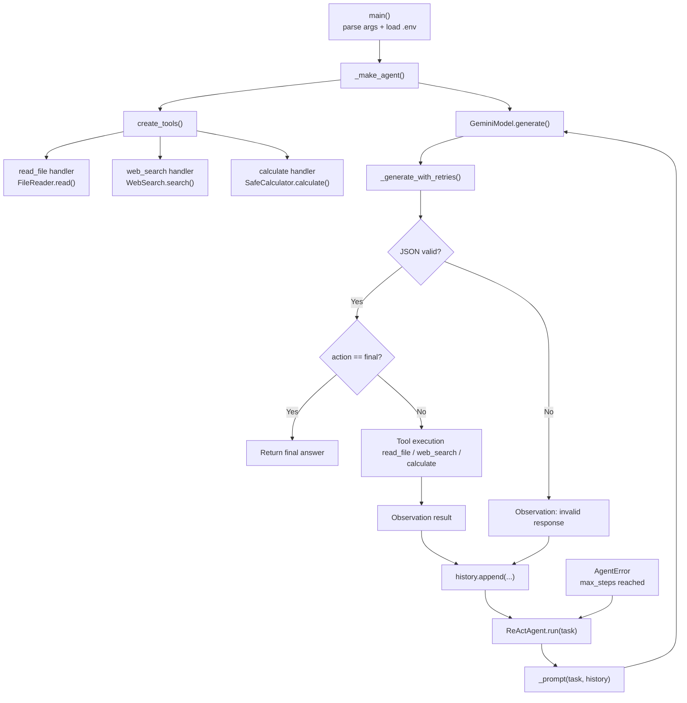

# Project Flow

This project is a compact, single-file ReAct agent built in [agent.py](./agent.py). The basic idea is:

1. The CLI starts the program.
2. It loads the Gemini API key from the environment or a `.env` file.
3. It creates the LLM client plus the three allowed tools.
4. The agent runs a bounded Thought -> Action -> Observation loop.
5. The model chooses one tool or a final answer, then the result is fed back into the next prompt.
6. The agent stops when the model produces a final answer or when the step limit is reached.

## End-to-end flow

- `main()` parses the task and model arguments.
- `load_dotenv()` loads the project environment file.
- `_make_agent()` creates:
  - `GeminiModel(api_key, model_name)`
  - `create_tools()`
  - `ReActAgent(...)`
- `ReActAgent.run(task)` starts the loop.
- Each iteration calls `_prompt(task, history)` to build a JSON-format response contract.
- `_generate_with_retries()` sends the prompt to Gemini with retry logic.
- `_validate_response()` checks that the model returned a valid JSON object containing `thought`, `action`, and `action_input`.
- If the action is `final`, the loop returns the answer.
- Otherwise, the matching tool handler runs.
- The tool result becomes the observation, which is appended to the history and used in the next model call.
- When the step limit is reached without a final answer, an `AgentError` is raised.

## Key functions and responsibilities

- `main()`
  - CLI entry point
  - loads env, builds the agent, runs the task, prints the final answer

- `_make_agent(model_name, max_steps)`
  - resolves the API key from env values
  - constructs the model and tools
  - returns a configured `ReActAgent`

- `GeminiModel.generate(prompt)`
  - calls the Gemini API
  - forces JSON output via `GenerateContentConfig(response_mime_type="application/json")`

- `create_tools()`
  - instantiates the tool classes
  - exposes three handlers: `read_file`, `web_search`, and `calculate`

- `FileReader.read(relative_path)`
  - only allows reads under `data/`
  - blocks path traversal attempts
  - enforces UTF-8 and byte-size limits

- `WebSearch.search(query, max_results)`
  - calls DuckDuckGo through `ddgs`
  - validates query length and result count
  - retries transient failures with backoff

- `SafeCalculator.calculate(expression)`
  - parses a safe AST
  - supports only numeric arithmetic and `round()`
  - rejects unsafe or unsupported expressions

- `ReActAgent.run(task)`
  - orchestrates the core loop
  - prints each step
  - invokes the model, validates the JSON, executes the selected tool, and records observations

- `_prompt(task, history)`
  - builds the instruction payload sent to Gemini
  - tells the model which tools are available and what JSON format to return

- `_generate_with_retries(prompt)`
  - wraps the Gemini call with retry/backoff behavior for transient network or API problems

- `_validate_response(response)`
  - ensures the model output follows the required structure before it is used

## Mermaid diagram

## Practical interpretation

The project is intentionally constrained to be safe and understandable:

- the model is not allowed to call arbitrary Python functions
- tools are allowlisted and validated
- the model must produce JSON, not free-form text
- every action is recorded as part of the prompt history so the agent can reason step by step
- tool errors are turned into observations rather than crashing the agent

This makes the project a simple, educational implementation of the ReAct pattern without a heavy framework.
