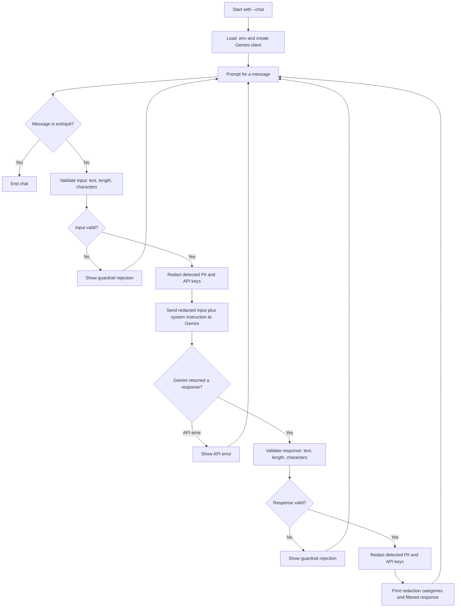

# AI Guardrail

A small Python pipeline that validates text before an LLM call and filters its
response. It uses Gemini through the official `google-genai` SDK.

## Protections

- Rejects empty/non-text input, oversized prompts and responses, and control or
  formatting characters.
- Places safety instructions in Gemini's separate system-instruction field;
  user prompts remain untrusted input.
- Redacts common email addresses, US phone numbers, SSNs, Luhn-valid payment
  card numbers, and common Gemini/OpenAI-style API keys before sending text to
  Gemini and again before returning the response.
- Reports which detected categories were redacted without printing the values.

Pattern-based detection is intentionally lightweight: it can miss PII outside
these formats and should not be treated as a compliance-grade DLP system.
System instructions and input/output checks reduce risk but cannot guarantee
that a model will resist every prompt-injection attempt.

## Setup

From `D:\assignments\ai-guardrail`:

```powershell
python -m venv .venv
.\.venv\Scripts\Activate.ps1
python -m pip install -r requirements.txt
$env:GEMINI_API_KEY = "your-key"
```

Keep API keys private. Do not commit credentials.

## Run

```powershell
python .\guardrail.py --prompt "Summarize this text: contact alex@example.com"
```

Input validation and redaction happen before the model request; response
validation and redaction happen before the result is printed.

For an interactive session, start chat mode:

```powershell
python .\guardrail.py --chat
```

Each message goes through the guarded pipeline before the chat prompts again:



## Adversarial and offline tests

```powershell
python -m unittest -v
```

Tests use a fake LLM, so they require no API key or network access. They cover
prompt-injection attempts, malformed/oversized input, PII in both directions,
and response-size filtering.
