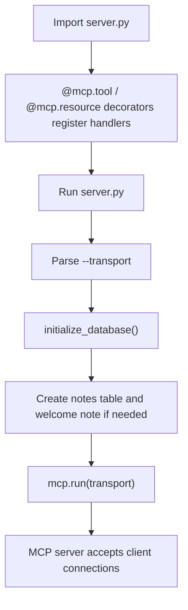
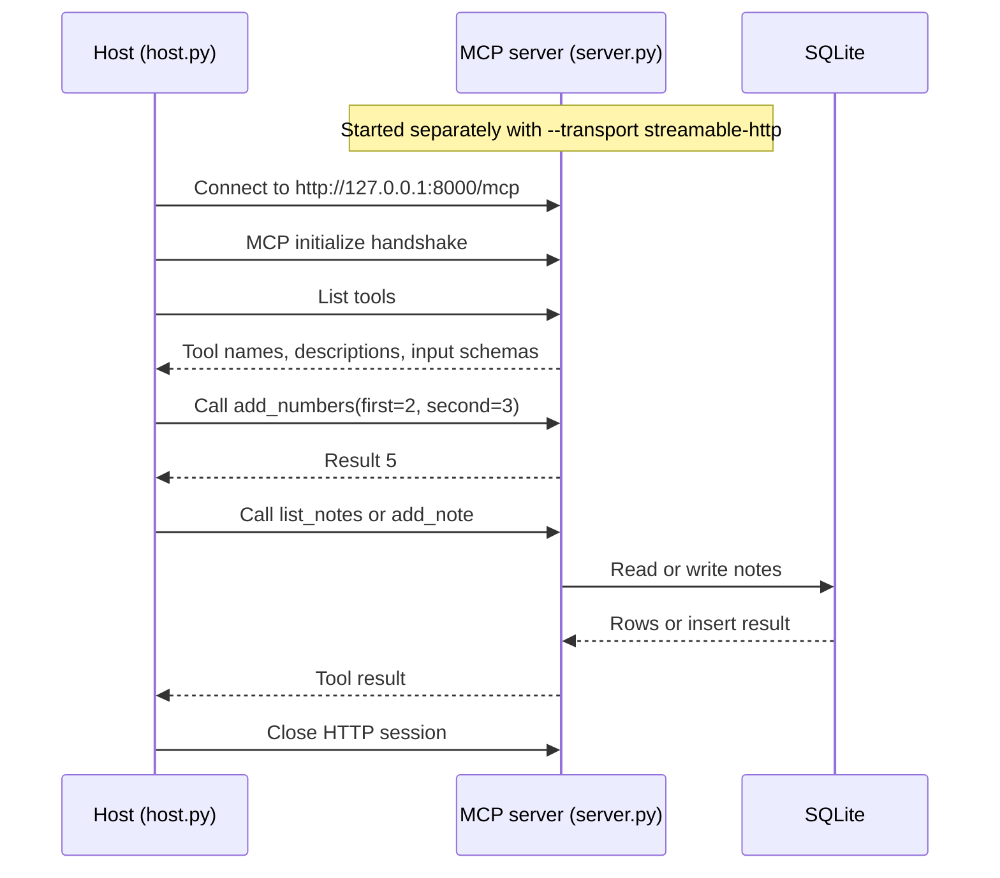

# MCP-Basic flows

This project has one MCP server, [server.py](./server.py), and a sample MCP
client/host, [host.py](./host.py). Both stdio and Streamable HTTP expose the
same tools. The server executes a tool only after a connected client requests
it. The sample host calls tools directly in Python; it does not use an LLM to
choose them.

## 1. Server startup and tool registration



### What the code does

- [server.py:12](./server.py#L12) creates the `FastMCP` server named
  `MCP-Basic`. The `@mcp.tool()` decorators at
  [server.py:49](./server.py#L49), [server.py:55](./server.py#L55),
  [server.py:61](./server.py#L61), and [server.py:72](./server.py#L72)
  register `add_numbers`, `count_words`, `list_notes`, and `add_note`.
  [server.py:88](./server.py#L88) registers the informational resource.
- [server.py:18](./server.py#L18) initializes the SQLite table and adds the
  welcome note once.
- At [server.py:99](./server.py#L99), command-line arguments select the
  transport. The database is initialized at [server.py:109](./server.py#L109)
  and MCP starts at [server.py:110](./server.py#L110).

For example, the `add_numbers` function is an ordinary Python function that
FastMCP exposes as a callable tool:

```python
@mcp.tool()
def add_numbers(first: float, second: float) -> float:
    return first + second
```

## 2. Stdio flow

The diagram below describes the Python host demo, started with
`.\.venv\Scripts\python.exe .\host.py`. VS Code can also start the stdio
server from [.vscode/mcp.json](./.vscode/mcp.json); in that case, Chat decides
whether to invoke a tool based on your request.

```mermaid
sequenceDiagram
    participant H as Host (host.py)
    participant P as Server process (server.py)
    participant DB as SQLite
    H->>P: Launch Python server with stdio pipes
    P->>P: Initialize database; FastMCP serves registered tools
    H->>P: MCP initialize handshake
    H->>P: List tools
    P-->>H: Tool names, descriptions, input schemas
    H->>P: Call add_numbers(first=2, second=3)
    P-->>H: Result 5
    H->>P: Call list_notes or add_note
    P->>DB: Read or write notes
    DB-->>P: Rows or insert result
    P-->>H: Tool result
    H->>P: Close stdio session
```

### What the code does

- In stdio mode, [host.py:79](./host.py#L79) sets the server executable,
  script, and environment; [host.py:84](./host.py#L84) launches it through
  `stdio_client`. The host and server communicate using stdin/stdout pipes,
  not an HTTP URL.
- [host.py:22](./host.py#L22) initializes the MCP session.
  [host.py:23](./host.py#L23) discovers the available tools.
- [host.py:28](./host.py#L28) explicitly calls `add_numbers` with `2` and
  `3`. No LLM is involved in this sample's tool selection.
- Database tools run on the server: `list_notes` reads rows at
  [server.py:62](./server.py#L62), while `add_note` inserts a row at
  [server.py:73](./server.py#L73).

## 3. Streamable HTTP flow

Start the server in one terminal:

```powershell
.\.venv\Scripts\python.exe .\server.py --transport streamable-http
```

Then connect the sample host from another terminal:

```powershell
.\.venv\Scripts\python.exe .\host.py --transport http
```



### What the code does

- On the server side, [server.py:110](./server.py#L110) invokes
  `mcp.run(transport=args.transport)`. With `streamable-http`, FastMCP serves
  the endpoint `http://127.0.0.1:8000/mcp`.
- On the host side, [host.py:69](./host.py#L69) selects the HTTP branch.
  [host.py:70](./host.py#L70) opens the Streamable HTTP connection using the
  URL supplied with `--url` or the default
  `http://127.0.0.1:8000/mcp`.
- Both transports pass their session to [run_demo](./host.py#L21), so the
  same initialization, discovery, and tool calls are used.
- For HTTP, the **server terminal** determines `MCP_BASIC_DB_PATH`. If it is
  unset, the server uses `demo.sqlite3` beside `server.py`.

## 4. Calling a specific tool

A host chooses the tool name and supplies the arguments matching that tool's
input schema. The key line in the sample host is
[host.py:28](./host.py#L28):

```python
sum_result = await session.call_tool(
    "add_numbers",
    {"first": 2, "second": 3},
)
```

`ClientSession.call_tool()` sends the MCP request. FastMCP dispatches it to
the registered `add_numbers` function at
[server.py:50](./server.py#L50), and its return value is sent back to the
host. The host prints the result at
[host.py:32](./host.py#L32).

Other calls in this demo:

```python
await session.call_tool("count_words", {"text": "MCP tools are callable"})
await session.call_tool("list_notes", {})
await session.call_tool(
    "add_note",
    {"title": "Example", "content": "Written through an MCP tool"},
)
```

The sample host runs these calls itself. An LLM is optional: an LLM-powered
host can choose a tool based on a user's request, but the MCP server only
executes the tool request it receives.

## 5. Calling a tool with MCP Inspector

Inspector is another host/client. It connects to the already-running HTTP
server, discovers its tools, and lets you invoke a selected tool from its UI.


For this project, choose **Streamable HTTP** in Inspector, use
`http://127.0.0.1:8000/mcp`, connect, then open **Tools** and invoke
`add_numbers` with `first` set to `2` and `second` set to `3`. Inspector
performs the same MCP tool-call operation as `session.call_tool()` in
[host.py:28](./host.py#L28); the server function is
[server.py:50](./server.py#L50).

The workspace also defines **MCP-Basic-HTTP** in
[.vscode/mcp.json](./.vscode/mcp.json). VS Code Chat can act as a host for
that entry and request tool calls. The sample `host.py` and Inspector invoke
tools explicitly; only an LLM-powered host uses a model to choose tools from
natural-language requests.
