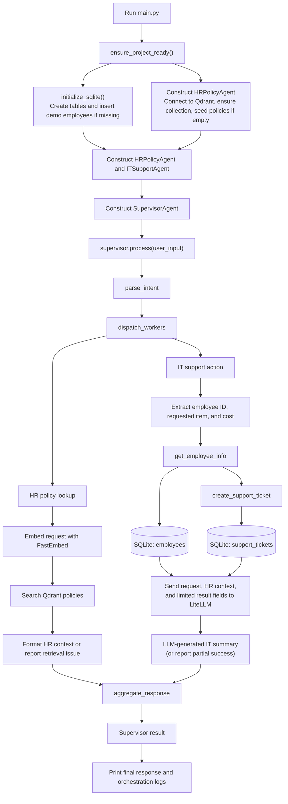

# Multi-Agent Helpdesk Flow

This diagram follows the executable path from [`main.py`](./main.py) through
the supervisor, worker agents, and data tools.

## What happens at each stage

1. **Prepare local data and retrieval.** `ensure_project_ready()` in
   [`main.py`](./main.py) initializes the SQLite schema and demo employee
   records, then constructs an HR agent. The HR agent connects to the default
   Qdrant endpoint (`http://localhost:6333`), creates its collection if
   necessary, and seeds policy text when that collection is empty.
2. **Run the workflow.** `SupervisorAgent` in
   [`src/agents/supervisor.py`](./src/agents/supervisor.py) calls three
   sequential steps: `parse_intent`, `dispatch_workers`, and
   `aggregate_response`.
3. **Dispatch both workers.** The supervisor's current dispatch logic calls
   both the HR and IT workflows for every recognized intent. The sample
   request contains policy-related keywords, so its intent is `policy_review`.
4. **Retrieve policy context.** [`src/agents/hr_agent.py`](./src/agents/hr_agent.py)
   embeds the request with FastEmbed, searches Qdrant, and formats the matching
   policy passages. The HR agent supplies guidance; its result does **not**
   currently control whether the IT ticket action runs.
5. **Look up the employee and create a ticket.**
   [`src/agents/it_agent.py`](./src/agents/it_agent.py) extracts the employee
   ID, requested item, and dollar amount from the input. It then invokes
   `get_employee_info` and `create_support_ticket` from
   [`src/tools/mcp_tools.py`](./src/tools/mcp_tools.py). These functions read
   and write the local `data/enterprise.db` database. After ticket creation,
   the IT agent sends the request, selected employee/ticket fields, and HR
   context to the RAG-Layered LiteLLM gateway for a concise Gemini-generated
   summary. The model does not execute tools or approve tickets.
6. **Assemble and print the result.** The supervisor combines HR context and
   IT output into one response, marks the workflow completed, and `main.py`
   prints the response and logs. A gateway failure after ticket creation is
   reported as a partial success including the ticket ID.

## Example request

The hard-coded request in `main.py` uses employee `1001`, asks about a new
MacBook Pro, and includes a cost of `$2200`. A successful run retrieves the
employee record and inserts a support ticket. Running the demo again can create
another ticket; policy guidance is presented in the final response but is not
an approval gate in the current implementation.

## MCP note

`mcp_tools.py` defines a FastMCP server and registers the employee and ticket
tools. However, the demo constructs `ITSupportAgent()` without passing an MCP
server, so its tool calls use the local Python functions directly. The entry
point does not start a separate MCP server.
