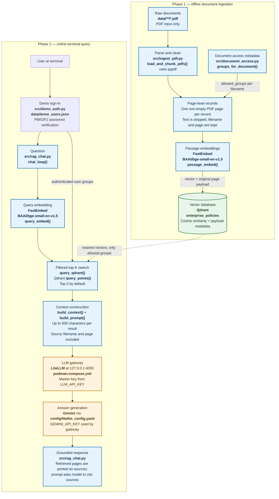

# RAG-Layered: component flow

This diagram maps the general RAG flow to the components that are actually
implemented in this project. **Bold component names** identify the concrete
scripts, libraries, services, and configuration files.

## What each phase does

### Phase 1: ingestion

1. **Input discovery:** `src/ingest_pdf.py` recursively finds PDF files under
   `data/`. The current ingestion implementation does not parse HTML, Word
   documents, or CSVs.
2. **Parsing and page records:** `pypdf` extracts text from each page. Empty
   pages are skipped, and each remaining page becomes one searchable record.
   This is page-level splitting—not a further subdivision into smaller
   overlapping text chunks. Each record keeps its source filename and
   one-based page number.
3. **Access metadata:** `groups_for_document()` maps each PDF filename to its
   allowed groups. An unmapped filename raises an error rather than silently
   making the document public.
4. **Embedding and indexing:** FastEmbed's `BAAI/bge-small-en-v1.5` model
   converts page text into vectors. The script replaces the
   `enterprise_policies` collection, then stores each vector with its text and
   source/access metadata in Qdrant. Re-running ingestion rebuilds the
   collection.

### Phase 2: retrieval and answer

1. **Sign-in:** `src/rag_chat.py` starts with interactive demo authentication.
   `src/demo_auth.py` verifies locally stored salted PBKDF2 password hashes
   from `data/demo_users.json` and returns the signed-in user's groups.
2. **Query embedding and retrieval:** `query_qdrant()` uses the same FastEmbed
   model to embed the question, then asks Qdrant for the three nearest page
   vectors by default. The Qdrant query also filters on `allowed_groups`, so
   retrieval is limited to the user's groups.
3. **Context and prompt:** `build_context()` includes each result's filename,
   page number, and a whitespace-normalized snippet capped at 500 characters.
   `build_prompt()` tells the model to answer only from the retrieved policy
   text, cite sources when possible, and say when the context lacks the answer.
4. **Gateway and model:** The CLI sends the prompt to LiteLLM's
   OpenAI-compatible chat-completions endpoint. `LLM_API_KEY` authenticates the
   CLI to the local proxy; the proxy uses `GEMINI_API_KEY` to call Gemini.
   `litellm_settings.drop_params` in `config/litellm_config.yaml` drops request
   parameters unsupported by the configured Gemini model.
5. **Result:** The CLI prints the retrieved source passages and then the
   generated answer. The source passages provide inspectable evidence; the
   model is instructed to cite source names, but citation formatting is not
   independently validated.

## Project-specific notes

- Qdrant and LiteLLM are local services started through the Compose files;
  Qdrant is available at `127.0.0.1:6333` and LiteLLM at
  `127.0.0.1:4000`.
- The demo's group filter is enforced by the CLI's Qdrant query. It is not a
  production security boundary: a client with direct Qdrant access can query
  the database without that filter.
- PDFs that contain only scanned images may yield no extractable text; this
  pipeline does not perform OCR.
- See [execution_steps.md](./execution_steps.md) for commands to run ingestion,
  create demo accounts, and start the chat.
